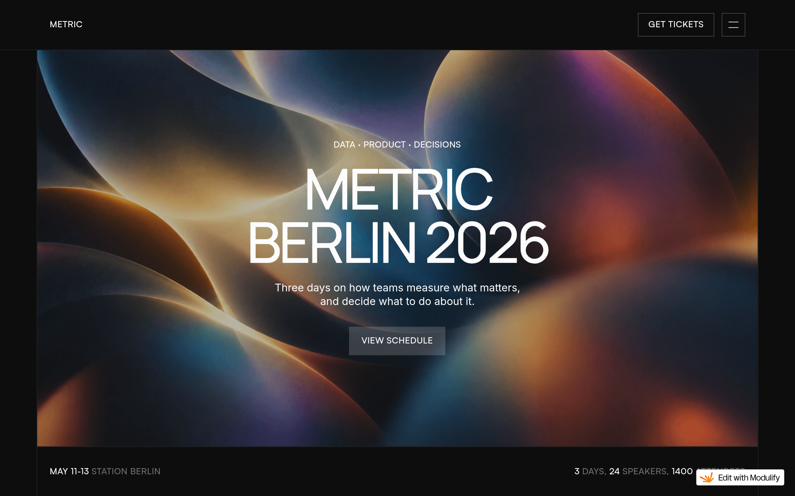

# metric-template Design System

You are building UI for **metric-template**. Dark-themed, warm palette, sans-serif typography (manrope), compact density on a 4px grid, flat elevation (no shadows), expressive motion.

## Visual Reference

**IMPORTANT**: Study ALL screenshots below before writing any UI. Match colors, typography, spacing, layout, and motion exactly as shown.

### Homepage



> Read `references/DESIGN.md` for full token details.

## Design Philosophy

- **Flat elevation** — depth through color shifts and borders, never shadows. Surfaces get progressively lighter to indicate elevation.
- **Solid colors only** — no gradients anywhere. Every surface is a single flat color.
- **Type pairing** — manrope for body/UI text, satoshi for headings/display. Never introduce a third typeface.
- **compact density** — 4px base grid. Every dimension is a multiple of 4.
- **warm palette** — the color temperature runs warm, matching the sans-serif typography.
- **Restrained accent** — `#e40014` is the only pop of color. Used exclusively for CTAs, links, focus rings, and active states.
- **Expressive motion** — animations are an integral part of the experience. Use spring physics and layout animations.

## Color System

### Core Palette

| Role | Token | Hex | Use |
|------|-------|-----|-----|
| Background | `--background` | `#0d0d0d` | Page/app background |
| Surface | `--surface` | `#1c1c1c` | Cards, panels, modals |
| Text Primary | `--text-primary` | `#ffffff` | Headings, body text |
| Text Muted | `--text-muted` | `#454545` | Captions, placeholders |
| Accent | `--accent` | `#e40014` | CTAs, links, focus rings |
| Border | `--border` | `#525252` | Dividers, card borders |

### Status Colors

| Status | Hex | Use |
|--------|-----|-----|
| Danger | `#ff9b8a` | Errors, destructive actions |

### Extended Palette

- **color-ink-mute:** `#6e6e6e`
- **color-black:** `#000000` — Deep background layer or shadow color
- **color-ink-soft:** `#d4d4d4`
- **chart-5:** `#262626`
- **sidebar-border:** `#e5e5e5` — Light surface or highlight color
- **sidebar-ring:** `#a1a1a1`

### CSS Variable Tokens

```css
--color-background: var(--background);
--color-foreground: var(--foreground);
--color-border: var(--border);
--background: #0d0d0d;
--foreground: #fcfcfc;
--card: #1c1c1c;
--card-foreground: #fcfcfc;
--popover: #131313;
--popover-foreground: #fcfcfc;
--primary: #fefff5;
--primary-foreground: #0d0d0d;
--secondary: #1c1c1c;
--secondary-foreground: #fcfcfc;
--muted: #1c1c1c;
--muted-foreground: #6e6e6e;
--accent: #212121;
--accent-foreground: #fcfcfc;
--destructive: #e40014;
--border: #212121;
--sidebar-foreground: #0a0a0a;
```

## Typography

### Font Stack

- **manrope** — Heading 1, Heading 2, Heading 3
- **satoshi** — Body, Caption
- **SFMono-Regular** — Code

### Font Sources

```css
@font-face {
  font-family: "satoshi";
  src: url("fonts/satoshi-Regular.woff2") format("woff2");
  font-weight: 400;
}
@font-face {
  font-family: "satoshi";
  src: url("fonts/satoshi-700.woff2") format("woff2");
  font-weight: 700;
}
@font-face {
  font-family: "manrope";
  src: url("fonts/manrope-700.woff2") format("woff2");
  font-weight: 700;
}
@font-face {
  font-family: "inter";
  src: url("fonts/inter-Regular.woff2") format("woff2");
  font-weight: 400;
}
```

### Type Scale

| Role | Family | Size | Weight |
|------|--------|------|--------|
| Heading 1 | manrope | 114px | 700 |
| Heading 2 | manrope | 91px | 700 |
| Heading 3 | manrope | 88px | 700 |
| Body | satoshi | 22px | 400 |
| Caption | satoshi | 16px | 400 |
| Code | SFMono-Regular | 14px | 400 |

### Typography Rules

- Body/UI: **manrope**, Headings: **satoshi** — these are the only display fonts
- Max 3-4 font sizes per screen
- Headings: weight 600-700, body: weight 400
- Use color and opacity for text hierarchy, not additional font sizes
- Line height: 1.5 for body, 1.2 for headings

## Spacing & Layout

### Base Grid: 4px

Every dimension (margin, padding, gap, width, height) must be a multiple of **4px**.

### Spacing Scale

`4, 8, 64, 80, 104` px

### Spacing as Meaning

| Spacing | Use |
|---------|-----|
| 4-8px | Tight: related items (icon + label, avatar + name) |
| 12-16px | Medium: between groups within a section |
| 24-32px | Wide: between distinct sections |
| 48px+ | Vast: major page section breaks |

### Border Radius

Scale: `9px`
Default: `9px`

### Container

Max-width: `1280px`, centered with auto margins.

### Breakpoints

| Name | Value |
|------|-------|
| sm | 40rem |
| md | 48rem |
| lg | 64rem |
| xl | 80rem |
| 2xl | 96rem |
| lg | 810px |
| 2xl | 1361px |

Mobile-first: design for small screens, layer on responsive overrides.

## Component Patterns

### Card

```css
.card {
  background: #1c1c1c;
  border: 1px solid #525252;
  border-radius: 9px;
  padding: 8px;
}
```

```html
<div class="card">
  <h3>Card Title</h3>
  <p>Card content goes here.</p>
</div>
```

### Button

```css
/* Primary */
.btn-primary {
  background: #e40014;
  color: #ffffff;
  border-radius: 9px;
  padding: 8px 8px;
  font-weight: 500;
  transition: opacity 150ms ease;
}
.btn-primary:hover { opacity: 0.9; }

/* Ghost */
.btn-ghost {
  background: transparent;
  border: 1px solid #525252;
  color: #ffffff;
  border-radius: 9px;
  padding: 8px 8px;
}
```

```html
<button class="btn-primary">Get Started</button>
<button class="btn-ghost">Learn More</button>
```

### Input

```css
.input {
  background: #0d0d0d;
  border: 1px solid #525252;
  border-radius: 9px;
  padding: 8px 8px;
  color: #ffffff;
  font-size: 14px;
}
.input:focus { border-color: #e40014; outline: none; }
```

```html
<input class="input" type="text" placeholder="Search..." />
```

### Badge / Chip

```css
.badge {
  display: inline-flex;
  align-items: center;
  padding: 4px 8px;
  border-radius: 9999px;
  font-size: 12px;
  font-weight: 500;
  background: #1c1c1c;
  color: #454545;
}
```

```html
<span class="badge">New</span>
<span class="badge">Beta</span>
```

### Modal / Dialog

```css
.modal-backdrop { background: rgba(0, 0, 0, 0.6); }
.modal {
  background: #1c1c1c;
  border: 1px solid #525252;
  border-radius: 9px;
  padding: 8px;
  max-width: 480px;
  width: 90vw;
}
```

```html
<div class="modal-backdrop">
  <div class="modal">
    <h2>Dialog Title</h2>
    <p>Dialog content.</p>
    <button class="btn-primary">Confirm</button>
    <button class="btn-ghost">Cancel</button>
  </div>
</div>
```

### Table

```css
.table { width: 100%; border-collapse: collapse; }
.table th {
  text-align: left;
  padding: 8px 8px;
  font-weight: 500;
  font-size: 12px;
  color: #454545;
  text-transform: uppercase;
  letter-spacing: 0.05em;
  border-bottom: 1px solid #525252;
}
.table td {
  padding: 8px;
  border-bottom: 1px solid #525252;
}
```

```html
<table class="table">
  <thead><tr><th>Name</th><th>Status</th><th>Date</th></tr></thead>
  <tbody>
    <tr><td>Item One</td><td>Active</td><td>Jan 1</td></tr>
    <tr><td>Item Two</td><td>Pending</td><td>Jan 2</td></tr>
  </tbody>
</table>
```

### Navigation

```css
.nav {
  display: flex;
  align-items: center;
  gap: 8px;
  padding: 8px 8px;
  border-bottom: 1px solid #525252;
}
.nav-link {
  color: #454545;
  padding: 8px 8px;
  border-radius: 9px;
  transition: color 150ms;
}
.nav-link:hover { color: #ffffff; }
.nav-link.active { color: #e40014; }
```

```html
<nav class="nav">
  <a href="/" class="nav-link active">Home</a>
  <a href="/about" class="nav-link">About</a>
  <a href="/pricing" class="nav-link">Pricing</a>
  <button class="btn-primary" style="margin-left: auto">Get Started</button>
</nav>
```

### Extracted Components

These components were found in the codebase:

**Button** (`html`)

**Input** (`html`)

**Navigation** (`html`)

## Page Structure

The following page sections were detected:

- **Navigation** — Top navigation bar (8 items)
- **Hero** — Hero section (detected from heading structure)
- **Faq** — FAQ/accordion section
- **Footer** — Page footer with links and info (10 items)

When building pages, follow this section order and structure.

## Animation & Motion

This project uses **expressive motion**. Animations are part of the design language.

### CSS Animations

- `fw-ticker-x`
- `fw-ticker-y`
- `spin`
- `pulse`
- `enter`

### Motion Tokens

- **Duration scale:** `.3s`, `.5s`, `.9s`, `180ms`, `450ms`
- **Easing functions:** `cubic-bezier(.16,1,.3,1)`, `ease`
- **Animated properties:** `transform`

### Motion Guidelines

- **Duration:** Use values from the duration scale above. Short (.3s) for micro-interactions, long (450ms) for page transitions
- **Easing:** Use `cubic-bezier(.16,1,.3,1)` as the default easing curve
- **Direction:** Elements enter from bottom/right, exit to top/left
- **Reduced motion:** Always respect `prefers-reduced-motion` — disable animations when set

## Depth & Elevation

This design uses **flat elevation** — no box-shadows anywhere.

### Elevation Strategy

| Level | Technique | Use |
|-------|-----------|-----|
| 0 — Base | Background color | Page background |
| 1 — Raised | Lighter surface + subtle border | Cards, panels |
| 2 — Floating | Even lighter surface + stronger border | Dropdowns, popovers |
| 3 — Overlay | Backdrop + modal surface | Modals, dialogs |

### Z-Index Scale

`2, 3, 7, 90, 100, 110, 120`

Use these exact values — never invent z-index values.

## Anti-Patterns (Never Do)

- **No box-shadow** on any element — use borders and surface colors for depth
- **No gradients** — solid colors only, everywhere
- **No blur effects** — no backdrop-blur, no filter: blur()
- **No zebra striping** — tables and lists use borders for separation
- **No invented colors** — every hex value must come from the palette above
- **No arbitrary spacing** — every dimension is a multiple of 4px
- **No extra fonts** — only manrope and satoshi and SFMono-Regular are allowed
- **No arbitrary border-radius** — use the scale: 9px
- **No opacity for disabled states** — use muted colors instead
- **No pill shapes** — this design doesn't use rounded-full / 9999px radius

## Workflow

1. **Read** `references/DESIGN.md` before writing any UI code
2. **Pick colors** from the Color System section — never invent new ones
3. **Set typography** — manrope, satoshi, SFMono-Regular only, using the type scale
4. **Build layout** on the 4px grid — check every margin, padding, gap
5. **Match components** to patterns above before creating new ones
6. **Apply elevation** — flat, surface color shifts only
7. **Validate** — every value traces back to a design token. No magic numbers.

## Brand Spec

- **Favicon:** `/favicon.svg`
- **Site URL:** `https://metric-template.modulify.website/`
- **Brand color:** `#e40014`
- **Brand typeface:** manrope

## Quick Reference

```
Background:     #0d0d0d
Surface:        #1c1c1c
Text:           #ffffff / #454545
Accent:         #e40014
Border:         #525252
Font:           manrope
Spacing:        4px grid
Radius:         9px
Components:     7 detected
```

## When to Trigger

Activate this skill when:
- Creating new components, pages, or visual elements for metric-template
- Writing CSS, Tailwind classes, styled-components, or inline styles
- Building page layouts, templates, or responsive designs
- Reviewing UI code for design consistency
- The user mentions "metric-template" design, style, UI, or theme
- Generating mockups, wireframes, or visual prototypes

---

# Full Reference Files

> Every output file is embedded below. Claude has full design system context from /skills alone.

## Design System Tokens (DESIGN.md)

# metric-template DESIGN.md

> Auto-generated design system — reverse-engineered via static analysis by skillui.
> Frameworks: None detected
> Colors: 14 · Fonts: 3 · Components: 7
> Icon library: not detected · State: not detected
> Primary theme: dark · Dark mode toggle: no · Motion: expressive

## Visual Reference

**Match this design exactly** — study colors, fonts, spacing, and component shapes before writing any UI code.


---

## 1. Visual Theme & Atmosphere

This is a **dark-themed** interface with a flat, warm visual language. Elevation is achieved through color and border shifts rather than shadows — a clean, industrial aesthetic. Typography pairs **satoshi** for display/headings with **manrope** for body text, creating clear visual hierarchy through type contrast. Spacing follows a **4px base grid** (compact density), with scale: 4, 8, 64, 80, 104px. The palette is predominantly monochromatic with **#e40014** as the single accent color — used sparingly for interactive elements and emphasis. Motion is expressive — spring physics, layout animations, and staggered reveals are part of the visual language.

---

## 2. Color Palette & Roles

| Token | Hex | Role | Use |
|---|---|---|---|
| theme-color | `#0d0d0d` | background | Page background, darkest surface |
| color-surface | `#1c1c1c` | surface | Card and panel backgrounds |
| tw-ring-offset-color | `#ffffff` | text-primary | Headings and body text |
| ring | `#454545` | text-muted | Captions, placeholders, secondary info |
| chart-3 | `#525252` | border | Dividers, card borders, outlines |
| destructive | `#e40014` | accent | CTAs, links, focus rings, active states |
| sidebar-accent | `#f5f5f5` | accent | CTAs, links, focus rings, active states |
| danger | `#ff9b8a` | danger | Error states, destructive actions |
| color-ink-mute | `#6e6e6e` | unknown | Palette color |
| color-black | `#000000` | unknown | Palette color |
| color-ink-soft | `#d4d4d4` | unknown | Palette color |
| chart-5 | `#262626` | unknown | Palette color |
| sidebar-border | `#e5e5e5` | unknown | Palette color |
| sidebar-ring | `#a1a1a1` | unknown | Palette color |

### CSS Variable Tokens

```css
--tw-border-style: solid;
--color-background: var(--background);
--color-foreground: var(--foreground);
--color-border: var(--border);
--background: #0d0d0d;
--foreground: #fcfcfc;
--card: #1c1c1c;
--card-foreground: #fcfcfc;
--popover: #131313;
--popover-foreground: #fcfcfc;
--primary: #fefff5;
--primary-foreground: #0d0d0d;
--secondary: #1c1c1c;
--secondary-foreground: #fcfcfc;
--muted: #1c1c1c;
--muted-foreground: #6e6e6e;
--accent: #212121;
--accent-foreground: #fcfcfc;
--destructive: #e40014;
--border: #212121;
```


---

## 3. Typography Rules

**Font Stack:**
- **manrope** — Heading 1, Heading 2, Heading 3
- **satoshi** — Body, Caption
- **SFMono-Regular** — Code

**Font Sources:**

```css
@font-face {
  font-family: "satoshi";
  src: url("fonts/satoshi-Regular.woff2") format("woff2");
  font-weight: 400;
}
@font-face {
  font-family: "satoshi";
  src: url("fonts/satoshi-700.woff2") format("woff2");
  font-weight: 700;
}
@font-face {
  font-family: "manrope";
  src: url("fonts/manrope-700.woff2") format("woff2");
  font-weight: 700;
}
@font-face {
  font-family: "inter";
  src: url("fonts/inter-Regular.woff2") format("woff2");
  font-weight: 400;
}
```

| Role | Font | Size | Weight |
|---|---|---|---|
| Heading 1 | manrope | 114px | 700 |
| Heading 2 | manrope | 91px | 700 |
| Heading 3 | manrope | 88px | 700 |
| Body | satoshi | 22px | 400 |
| Caption | satoshi | 16px | 400 |
| Code | SFMono-Regular | 14px | 400 |

**Typographic Rules:**
- Limit to 3 font families max per screen
- Use **manrope** for body/UI text, **satoshi** for display/headings
- Maintain consistent hierarchy: no more than 3-4 font sizes per screen
- Headings use bold (600-700), body uses regular (400)
- Line height: 1.5 for body text, 1.2 for headings
- Use color and opacity for secondary hierarchy, not additional font sizes


---

## 4. Component Stylings

### Layout (1)

**Footer** — `html`

### Navigation (1)

**Navigation** — `html`

### Data Input (2)

**Button** — `html`
- Animation: 

**Input** — `html`
- State: :focus, :placeholder

### Media (3)

**Image** — `html`

**Icon** — `html`

**Map/Canvas** — `html`


---

## 5. Layout Principles

- **Base spacing unit:** 4px
- **Spacing scale:** 4, 8, 64, 80, 104
- **Border radius:** 9px
- **Max content width:** 1280px

**Spacing as Meaning:**
| Spacing | Use |
|---|---|
| 4-8px | Tight: related items within a group |
| 12-16px | Medium: between groups |
| 24-32px | Wide: between sections |
| 48px+ | Vast: major section breaks |


---

## 6. Depth & Elevation

No box-shadow values detected. The design uses a **flat visual style** — elevation is conveyed through background color shifts and borders rather than shadows.

**Elevation Strategy:**
| Level | Technique | Use |
|---|---|---|
| 0 — Base | Background color | Page background |
| 1 — Raised | Lighter surface + subtle border | Cards, panels |
| 2 — Floating | Even lighter surface + stronger border | Dropdowns, popovers |
| 3 — Overlay | Backdrop + modal surface | Modals, dialogs |

**Z-Index Scale:** `2, 3, 7, 90, 100, 110, 120`


---

## 7. Animation & Motion

This project uses **expressive motion**. Animations are an integral part of the experience.

### CSS Animations

- `@keyframes fw-ticker-x`
- `@keyframes fw-ticker-y`
- `@keyframes spin`
- `@keyframes pulse`
- `@keyframes enter`
- `@keyframes exit`

### Animated Components

- **Button**: 

### Motion Guidelines

- Duration: 150-300ms for micro-interactions, 300-500ms for page transitions
- Easing: `ease-out` for enters, `ease-in` for exits
- Always respect `prefers-reduced-motion`


---

## 8. Do's and Don'ts

### Do's

- Use `#e40014` for interactive elements (buttons, links, focus rings)
- Use `#0d0d0d` as the primary page background
- Pair **manrope** (body) with **satoshi** (display) — these are the only allowed fonts
- Follow the **4px** spacing grid for all margins, padding, and gaps
- Use border and background shifts for elevation — not shadows
- Use border-radius from the scale: 9px
- Reuse existing components from Section 4 before creating new ones

### Don'ts

- Don't introduce colors outside this palette — extend the design tokens first
- Don't introduce additional font families beyond manrope and satoshi and SFMono-Regular
- Don't use arbitrary spacing values — stick to multiples of 4px
- Don't add box-shadow — this design system uses flat elevation
- Don't use gradients — the design uses solid colors only
- Don't use arbitrary border-radius values — pick from the defined scale
- Don't duplicate component patterns — check Section 4 first
- Don't use backdrop-blur or blur effects

### Anti-Patterns (detected from codebase)

- No box-shadow on any element
- No gradient backgrounds
- No blur or backdrop-blur effects
- No zebra striping on tables/lists


---

## 9. Responsive Behavior

| Name | Value | Source |
|---|---|---|
| sm | 40rem | css |
| md | 48rem | css |
| lg | 64rem | css |
| xl | 80rem | css |
| 2xl | 96rem | css |
| lg | 810px | css |
| 2xl | 1361px | css |

**Approach:** Use `@media (min-width: ...)` queries matching the breakpoints above.


---

## 10. Agent Prompt Guide

Use these as starting points when building new UI:

### Build a Card

```
Background: #1c1c1c
Border: 1px solid #525252
Radius: 9px
Padding: 8px
Font: manrope
No shadows — use borders and surface colors for depth.
```

### Build a Button

```
Primary: bg #e40014, text white
Ghost: bg transparent, border #525252
Padding: 8px 8px
Radius: 9px
Hover: opacity 0.9 or lighter shade
Focus: ring with #e40014
```

### Build a Page Layout

```
Background: #0d0d0d
Max-width: 1280px, centered
Grid: 4px base
Responsive: mobile-first, breakpoints from Section 9
```

### Build a Stats Card

```
Surface: #1c1c1c
Label: #454545 (muted, 12px, uppercase)
Value: #ffffff (primary, 24-32px, bold)
Status: use success/warning/danger from Section 2
```

### Build a Form

```
Input bg: #0d0d0d
Input border: 1px solid #525252
Focus: border-color #e40014
Label: #454545 12px
Spacing: 8px between fields
Radius: 9px
```

### General Component

```
1. Read DESIGN.md Sections 2-6 for tokens
2. Colors: only from palette
3. Font: manrope, type scale from Section 3
4. Spacing: 4px grid
5. Components: match patterns from Section 4
6. Elevation: flat, surface shifts
```

## Bundled Fonts (fonts/)

The following font files are bundled in the `fonts/` directory:

- `fonts/inter-500.woff2`
- `fonts/inter-600.woff2`
- `fonts/inter-Regular.woff2`
- `fonts/manrope-500.woff2`
- `fonts/manrope-700.woff2`
- `fonts/satoshi-500.woff2`
- `fonts/satoshi-700.woff2`
- `fonts/satoshi-Regular.woff2`

Use these local font files in `@font-face` declarations instead of fetching from Google Fonts.

## Homepage Screenshots (screenshots/)


